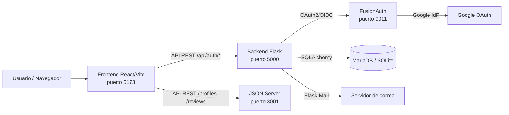
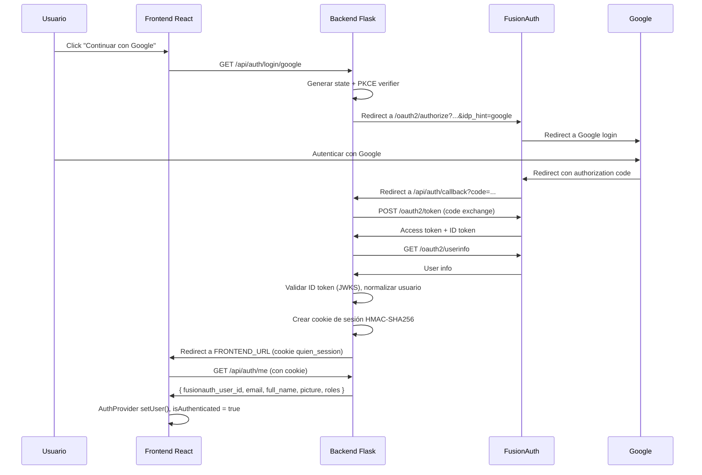
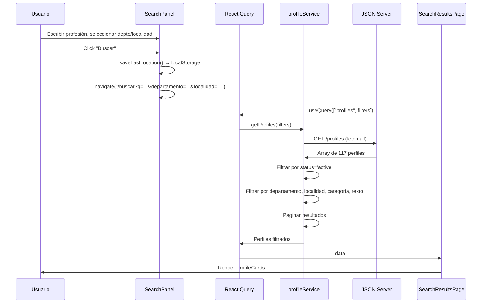
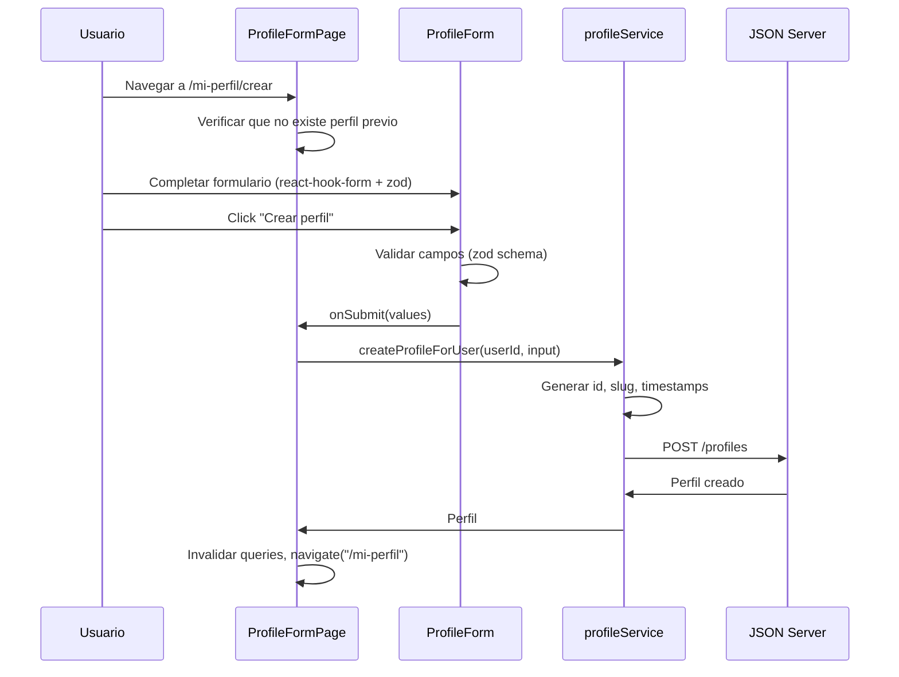
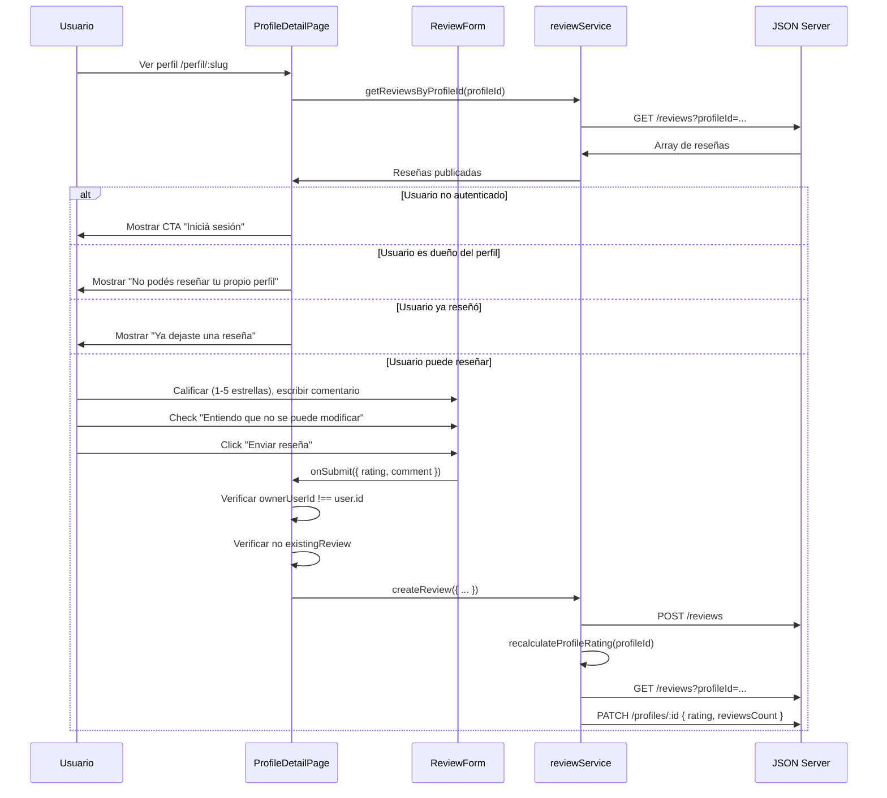
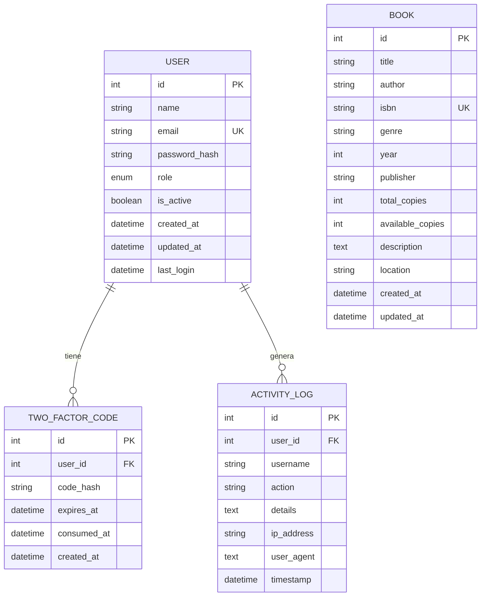
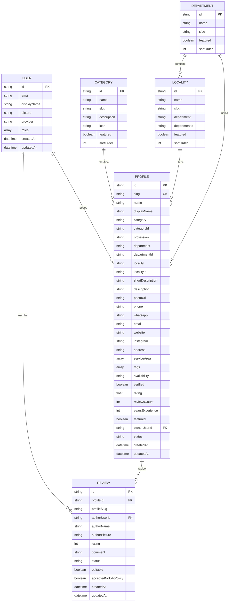
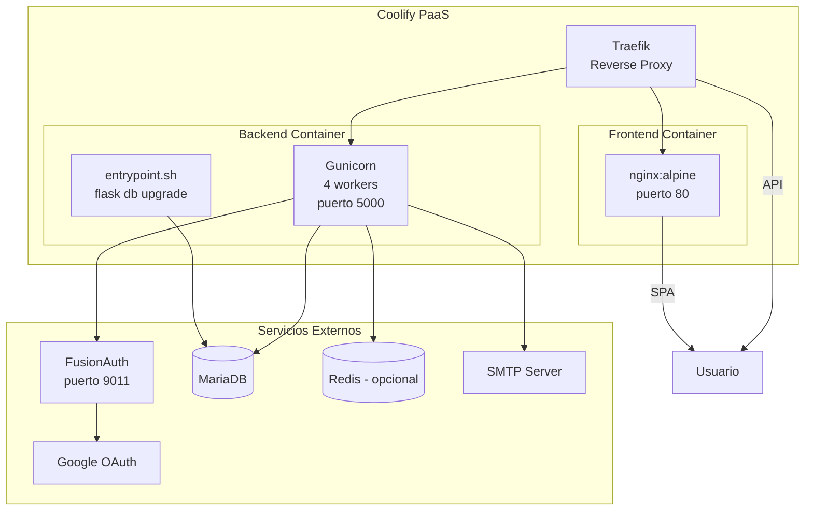

> **Documento histórico.** Describe una etapa anterior con JSON Server y rutas que ya no representan la demo local. Para los componentes y diagramas vigentes, consultá [Arquitectura-Actual.md](docs/Arquitectura-Actual.md); para instalar, [Guia-para-otro-equipo.md](docs/Guia-para-otro-equipo.md).

# Arquitectura de Quien.uy

## 1. Resumen ejecutivo

Quien.uy es un directorio de profesionales, oficios y servicios para Uruguay. El proyecto consiste en una SPA React (Vite + TypeScript) como frontend, un backend Flask (Python 3.11) que gestiona autenticación OIDC contra FusionAuth, y un mock server JSON Server que simula el API de dominio durante desarrollo.

La arquitectura actual es un **sistema dual**: el backend Flask maneja exclusivamente autenticación y administración (libros, usuarios, panel admin HTML), mientras que los datos de dominio del Quien.uy (perfiles, reseñas, categorías, departamentos, localidades) se sirven desde JSON Server en el puerto 3001. Esta separación es temporal para desarrollo; en producción, todos los endpoints deberían confluir en el backend Flask.

El sistema de autenticación principal utiliza OAuth2/OIDC con PKCE contra FusionAuth, con Google como proveedor de identidad externo. Las sesiones se manejan mediante cookies HTTP-only firmadas con HMAC-SHA256. Existe además un sistema legacy de autenticación JWT con email+contraseña+2FA que sirve al panel administrativo HTML.

## 2. Alcance del análisis

Este documento analiza el código fuente real del repositorio en `C:\Users\Nebyx\Documents\Test-Projects\auth-demo`. Se inspeccionaron:

- **Frontend:** 60+ archivos TypeScript/TSX en `src/`
- **Backend:** 20+ archivos Python en `backend/app/`
- **Configuración:** Dockerfiles, nginx.conf, vite.config.ts, package.json, requirements.txt
- **Datos:** db.json (6249 líneas), uruguayLocations.ts, landingData.ts

No se encontraron archivos Docker Compose, configuraciones CI/CD (.github/workflows), ni archivos de configuración de Coolify en el repositorio. La integración con Coolify se infiere de los Dockerfiles y gunicorn.conf.py.

## 3. Estructura del repositorio

```
auth-demo/
├── .env                          # VITE_AUTH_API_DOMAIN, VITE_WEBSITE_DOMAIN
├── .env.example                  # VITE_API_BASE_URL (JSON Server)
├── Dockerfile                    # Frontend: node:20-alpine → nginx:alpine
├── nginx.conf                    # SPA fallback, gzip, cache, /health
├── package.json                  # Dependencias frontend
├── vite.config.ts                # Vite: React, Tailwind v4, @ alias, /api proxy
├── tsconfig.json                 # TS project references
├── tsconfig.app.json             # TS config para src/
├── tsconfig.node.json            # TS config para vite.config.ts
├── eslint.config.js              # ESLint flat config
├── index.html                    # SPA entry point (lang="es", Manrope font)
├── README.md                     # Documentación del proyecto
├── report.md                     # Reporte de investigación de navegación
│
├── public/
│   ├── favicon.svg
│   └── icons.svg
│
├── src/                          # FRONTEND
│   ├── main.tsx                  # Entry point: createRoot → <App />
│   ├── App.tsx                   # Providers: QueryClient → Theme → Auth → Router
│   │
│   ├── api/                      # Capa HTTP
│   │   ├── client.ts             # Axios (port 5000, withCredentials)
│   │   ├── queryClient.ts        # TanStack Query client
│   │   ├── auth.ts               # Legacy JWT auth API
│   │   └── books.ts              # Legacy books API
│   │
│   ├── common/
│   │   └── MainLayout.tsx        # Layout protegido (Navbar + Outlet + Footer)
│   │
│   ├── components/
│   │   ├── ProfileAvatar.tsx     # Avatar con fallback de iniciales
│   │   ├── auth/
│   │   │   └── AuthCallbackLoading.tsx
│   │   ├── landing/              # 16 componentes de la landing page
│   │   │   ├── Navbar.tsx        # Navegación principal
│   │   │   ├── Footer.tsx
│   │   │   ├── HeroSection.tsx
│   │   │   ├── SearchPanel.tsx   # Formulario de búsqueda
│   │   │   ├── ProfessionAutocomplete.tsx
│   │   │   ├── CategorySection.tsx
│   │   │   ├── CategoryCard.tsx
│   │   │   ├── FeaturedProfilesSection.tsx
│   │   │   ├── ProfileCard.tsx   # Tarjeta de perfil reutilizable
│   │   │   ├── HowItWorksSection.tsx
│   │   │   ├── ProviderCTASection.tsx
│   │   │   ├── TerritorySection.tsx
│   │   │   ├── TrustSection.tsx
│   │   │   ├── ThemeToggle.tsx
│   │   │   ├── QuickChips.tsx
│   │   │   └── HeroProfileBento.tsx
│   │   ├── profiles/
│   │   │   ├── ProfileForm.tsx   # Formulario crear/editar perfil
│   │   │   ├── ReviewForm.tsx    # Formulario de reseña
│   │   │   ├── ReviewCard.tsx    # Tarjeta de reseña
│   │   │   └── OwnerBanner.tsx   # Banner para propietarios
│   │   └── ui/
│   │       ├── ConfirmDialog.tsx
│   │       ├── LoadingSpinner.tsx
│   │       └── MathCaptcha.tsx
│   │
│   ├── config/
│   │   └── api.ts                # API_BASE_URL (port 3001, JSON Server)
│   │
│   ├── data/
│   │   ├── db.json               # Mock DB (117 perfiles, 5 reseñas, 20 usuarios)
│   │   └── uruguayLocations.ts   # 19 departamentos → localidades
│   │
│   ├── lib/
│   │   ├── auth.tsx              # AuthProvider + useAuth (FusionAuth OIDC)
│   │   ├── useUserProfile.ts     # Wrapper de useAuth
│   │   └── cn.ts                 # clsx + tailwind-merge
│   │
│   ├── pages/
│   │   ├── landing/
│   │   │   ├── LandingPage.tsx
│   │   │   └── landingData.ts
│   │   ├── AuthPage.tsx          # OAuth callback handler
│   │   ├── LoginPage.tsx         # Login explícito (no auto-OAuth)
│   │   ├── LoginRequiredPage.tsx # Redirect a /login
│   │   ├── ProfileDetailPage.tsx # Perfil público con reseñas
│   │   ├── ProfileFormPage.tsx   # Crear/editar perfil (protegido)
│   │   ├── MyAccountPage.tsx     # Cuenta del usuario (protegido)
│   │   ├── MyProfilePage.tsx     # Dashboard de perfil (protegido)
│   │   ├── MyReviewsPage.tsx     # Reseñas del usuario (protegido)
│   │   ├── SearchResultsPage.tsx # Resultados de búsqueda
│   │   ├── NearMePage.tsx        # Sugerencias por ubicación
│   │   └── NotFoundPage.tsx      # 404
│   │
│   ├── router/
│   │   ├── AppRouter.tsx         # BrowserRouter con todas las rutas
│   │   └── ProtectedRoute.tsx    # Guard de autenticación
│   │
│   ├── services/
│   │   ├── profileService.ts     # CRUD de perfiles (JSON Server)
│   │   ├── locationService.ts    # Ubicación y geolocalización
│   │   └── reviewService.ts      # CRUD de reseñas + recálculo de rating
│   │
│   ├── store/
│   │   └── themeStore.ts         # Zustand: tema claro/oscuro
│   │
│   ├── styles/
│   │   ├── global.css            # Tailwind v4 + DaisyUI themes
│   │   ├── ThemeProvider.tsx     # Sync data-theme attribute
│   │   ├── theme.ts              # Placeholder (legacy)
│   │   └── darkMode.css          # Placeholder (vacío)
│   │
│   ├── types/
│   │   ├── profile.ts            # Profile, Review, Category, Department, etc.
│   │   └── index.ts              # UserProfile, User, Book (legacy)
│   │
│   └── utils/
│       ├── normalizeText.ts
│       ├── textSearch.ts         # MiniSearch para búsqueda full-text
│       ├── professionSuggestions.ts
│       ├── searchParams.ts
│       └── slugify.js
│
├── backend/                      # BACKEND
│   ├── .env                      # FusionAuth creds, session config
│   ├── Dockerfile                # python:3.11-slim + gunicorn
│   ├── entrypoint.sh             # flask db upgrade → gunicorn
│   ├── gunicorn.conf.py          # 4 workers, gthread, 60s timeout
│   ├── requirements.txt          # 22 dependencias Python
│   ├── app.py                    # Entry point desarrollo
│   ├── wsgi.py                   # Entry point producción
│   │
│   └── app/
│       ├── __init__.py           # create_app() factory
│       ├── config.py             # Config class (DB, JWT, CORS, FusionAuth)
│       ├── extensions.py         # db, migrate, mail, jwt, limiter, csrf
│       ├── health.py             # /health endpoint
│       ├── commands.py           # CLI: create-admin, init-db, seed-demo
│       │
│       ├── admin/                # Panel HTML de administración
│       │   ├── routes.py         # /admin/* rutas HTML
│       │   └── forms.py          # WTForms
│       │
│       ├── api/                  # API REST
│       │   ├── __init__.py       # Blueprint registration
│       │   ├── auth_routes.py    # FusionAuth OIDC (/api/auth/*)
│       │   ├── fusionauth.py     # Servicio OIDC (PKCE, tokens, sesiones)
│       │   ├── auth.py           # Legacy JWT auth (/auth/*)
│       │   ├── books.py          # CRUD de libros (/api/books/*)
│       │   └── users.py          # CRUD de usuarios (/api/users/*)
│       │
│       ├── models/
│       │   ├── user.py           # User, TwoFactorCode, ActivityLog
│       │   └── book.py           # Book
│       │
│       ├── services/
│       │   └── email_service.py  # Envío de emails (2FA, bienvenida)
│       │
│       ├── templates/
│       │   ├── admin/            # Jinja2 templates del panel admin
│       │   └── errors/           # 404 template
│       │
│       └── utils/
│           └── logging_helper.py # Activity logging
│
└── dist/                         # Build output (generado)
```

## 4. Visión general de la arquitectura



**Flujo de autenticación:**
1. Frontend redirige a `/api/auth/login/google` en el backend
2. Backend genera state + PKCE, redirige a FusionAuth
3. FusionAuth redirige a Google
4. Google autentica, FusionAuth redirige al callback del backend
5. Backend intercambia el código por tokens, valida ID token, crea cookie de sesión HTTP-only
6. Backend redirige al frontend
7. Frontend llama a `/api/auth/me` para obtener el usuario

**Flujo de datos de dominio:**
- Los perfiles, reseñas, categorías, departamentos y localidades se sirven desde JSON Server
- El frontend aplica filtros del lado del cliente (mock behavior)
- En producción, estos endpoints deberían moverse al backend Flask

## 5. Arquitectura del frontend

### 5.1 Framework y herramientas

| Componente | Tecnología | Versión |
|------------|-----------|---------|
| Framework | React | ^19.2.5 |
| Lenguaje | TypeScript | ~6.0.2 |
| Build tool | Vite | ^8.0.9 |
| Router | react-router-dom | ^7.14.2 |
| State (server) | @tanstack/react-query | ^5.99.2 |
| State (client) | Zustand | ^5.0.12 |
| HTTP client | Axios | ^1.15.2 |
| CSS | Tailwind CSS | ^4.1.11 |
| UI components | DaisyUI | ^5.0.43 |
| Iconos | lucide-react | ^1.23.0 |
| Animaciones | framer-motion | ^12.38.0 |
| Formularios | react-hook-form | ^7.73.1 |
| Validación | Zod | ^4.3.6 |
| Búsqueda | MiniSearch | ^7.2.0 |

### 5.2 Estructura de providers

```
<QueryClientProvider>
  <ThemeProvider>
    <AuthProvider>
      <AppRouter />
    </AuthProvider>
  </ThemeProvider>
</QueryClientProvider>
```

Definido en `src/App.tsx`.

### 5.3 Sistema de rutas

Router definido en `src/router/AppRouter.tsx` usando `BrowserRouter` de react-router-dom v7.

| Ruta | Componente | Acceso |
|------|-----------|--------|
| `/` | LandingPage | Público |
| `/buscar` | SearchResultsPage | Público |
| `/buscar/:department` | SearchResultsPage | Público |
| `/buscar/:department/:locality` | SearchResultsPage | Público |
| `/cerca-de-mi` | NearMePage | Público |
| `/perfil/:slug` | ProfileDetailPage | Público |
| `/login` | LoginPage | Público |
| `/auth/*` | AuthPage | Público (callback OAuth) |
| `/login-required` | LoginRequiredPage | Público (redirect legacy) |
| `/mi-cuenta` | MyAccountPage | **Protegido** |
| `/mi-perfil` | MyProfilePage | **Protegido** |
| `/mi-perfil/crear` | ProfileFormPage | **Protegido** |
| `/mi-perfil/editar` | ProfileFormPage | **Protegido** |
| `/mis-reviews` | MyReviewsPage | **Protegido** |
| `/dashboard` | Redirect → `/mi-cuenta` | Legacy |
| `/catalog` | Redirect → `/mi-cuenta` | Legacy |
| `*` | NotFoundPage | 404 |

Las rutas protegidas están envueltas en `<ProtectedRoute>` que renderiza `<MainLayout>` (Navbar + Outlet + Footer). `ProtectedRoute` redirige a `/login?next=<ruta>` si el usuario no está autenticado.

### 5.4 Capa de servicios

Tres servicios en `src/services/` comunican con JSON Server (puerto 3001) usando `fetch()` nativo:

**profileService.ts:** CRUD de perfiles con filtrado del lado del cliente. Funciones: `getProfiles`, `getProfileBySlug`, `getProfileById`, `createProfileForUser`, `updateOwnedProfile`, `deleteOwnedProfile`, `deactivateOwnedProfile`, `getProfileByOwnerUserId`. Implementa verificación de propiedad antes de editar/eliminar.

**reviewService.ts:** CRUD de reseñas. Funciones: `getReviewsByProfileId`, `getReviewsByAuthorUserId`, `createReview`, `updateReview`, `deleteReview`, `userHasReviewedProfile`, `recalculateProfileRating`. Implementa restricciones de negocio del lado del cliente (un usuario no puede reseñar su propio perfil, no puede reseñar dos veces).

**locationService.ts:** Resolución de ubicación. Funciones: `getPredictedLocation`, `saveLastLocation`, `getDepartments`, `getLocalitiesByDepartment`. Predicción por URL params → localStorage → default (Lavalleja/Minas).

### 5.5 Gestión de estado

| Capa | Mecanismo | Ejemplo |
|------|-----------|---------|
| Estado de servidor | React Query (TanStack) | Perfiles, reseñas, ubicaciones |
| Estado de autenticación | React Context (AuthProvider) | Usuario actual, isAuthenticated |
| Estado de tema | Zustand + localStorage | `quienLight` / `quienDark` |
| Estado de UI | useState local | Formularios, modales, drawer |

### 5.6 Sistema de estilos

- **Tailwind CSS v4** configurado en `src/styles/global.css` con `@import "tailwindcss"`
- **DaisyUI v5** con dos temas personalizados: `quienLight` y `quienDark`
- Tema `quienLight`: base crema (#FFF8EF), primary teal (#00A878), accent coral (#FF6B5A)
- Tema `quienDark`: base verde oscuro (#101816), primary teal claro (#22D3A6)
- Fuente: Manrope, Inter, system-ui
- Persistencia del tema en localStorage via Zustand
- Sincronización del atributo `data-theme` en `<html>` via ThemeProvider

### 5.7 Variables de entorno del frontend

| Variable | Valor por defecto | Uso |
|----------|------------------|-----|
| `VITE_AUTH_API_DOMAIN` | `http://localhost:5000` | URL del backend Flask (auth) |
| `VITE_API_BASE_URL` | `http://localhost:3001` | URL de JSON Server (mock) |
| `VITE_WEBSITE_DOMAIN` | `http://localhost:5173` | URL del frontend |

### 5.8 Tabla de componentes principales

| Componente | Ubicación | Responsabilidad | Dependencias | API/Servicio |
|------------|-----------|-----------------|--------------|--------------|
| Navbar | `src/components/landing/Navbar.tsx` | Navegación principal, estado auth, menú móvil | useAuth, useNavigate, queryClient | Ninguno directamente |
| SearchPanel | `src/components/landing/SearchPanel.tsx` | Formulario de búsqueda (profesión, depto, localidad) | ProfessionAutocomplete, uruguayLocations | getProfiles (react-query) |
| ProfileCard | `src/components/landing/ProfileCard.tsx` | Tarjeta de perfil reutilizable | ProfileAvatar | Ninguno (datos por props) |
| ProfileForm | `src/components/profiles/ProfileForm.tsx` | Formulario crear/editar perfil | react-hook-form, zod, uruguayLocations | PerfilService vía props |
| ReviewForm | `src/components/profiles/ReviewForm.tsx` | Formulario de reseña con checkbox de no-edición | useState | reviewService vía props |
| ReviewCard | `src/components/profiles/ReviewCard.tsx` | Tarjeta de reseña | ProfileAvatar | Ninguno (datos por props) |
| ProtectedRoute | `src/router/ProtectedRoute.tsx` | Guard de autenticación | useAuth, Navigate | /api/auth/me vía AuthProvider |
| AuthProvider | `src/lib/auth.tsx` | Contexto de autenticación OIDC | apiClient (axios) | /api/auth/me, /api/auth/logout |
| ThemeProvider | `src/styles/ThemeProvider.tsx` | Sincronización de tema DaisyUI | useThemeStore | Ninguno |
| MainLayout | `src/common/MainLayout.tsx` | Layout protegido con Navbar/Footer | Navbar, Footer, Outlet | Ninguno |

## 6. Arquitectura del backend

### 6.1 Framework y stack

| Componente | Tecnología | Versión |
|------------|-----------|---------|
| Framework | Flask | 3.1.2 |
| ORM | Flask-SQLAlchemy + SQLAlchemy | 3.1.1 / 2.0.46 |
| Migraciones | Flask-Migrate + Alembic | 4.1.0 / 1.18.1 |
| Autenticación JWT | Flask-JWT-Extended | 4.7.1 |
| Autenticación sesión | Flask-Login | 0.6.3 |
| Formularios | Flask-WTF | 1.2.2 |
| CORS | Flask-Cors | 6.0.2 |
| Rate limiting | Flask-Limiter | 4.1.1 |
| Email | Flask-Mail | 0.10.0 |
| Hashing | argon2-cffi | 25.1.0 |
| JWT | PyJWT | 2.10.1 |
| HTTP client | requests | 2.32.4 |
| Servidor producción | Gunicorn | 24.1.1 |
| DB (producción) | MariaDB (via mariadb connector) | 1.1.14 |
| DB (desarrollo) | SQLite | (built-in) |
| Caché (opcional) | Redis | 7.2.0 |

### 6.2 Application Factory

El backend usa el patrón Application Factory en `backend/app/__init__.py`:

```python
def create_app(config_class=Config) -> Flask:
```

Secuencia de inicialización:
1. Crear app Flask con `backend/public/` como static folder
2. Aplicar configuración desde `Config` class
3. Configurar CORS global
4. Inicializar extensiones: db, migrate, mail, jwt, csrf, login_manager, limiter
5. Registrar user loader de Flask-Login
6. Registrar error handlers JWT (401, 422)
7. Registrar 5 blueprints: health_bp, api_bp, auth_public_bp, fusionauth_bp, admin_bp
8. Exempt API blueprints de CSRF
9. Registrar CLI commands
10. Importar modelos para Flask-Migrate

### 6.3 Blueprints

| Blueprint | Prefijo | Propósito | Autenticación |
|-----------|---------|-----------|---------------|
| `health_bp` | `/` | Health check | Ninguna |
| `api_bp` | `/api` | REST API (books, users) | JWT Bearer |
| `auth_public_bp` | `/` | Auth legacy (login, verify-2fa) | JWT pending/access |
| `fusionauth_bp` | `/api/auth` | OIDC FusionAuth | Cookie de sesión |
| `admin_bp` | `/admin` | Panel HTML admin | Flask-Login session |

### 6.4 Modelos de datos (Backend SQLAlchemy)

**User** (`backend/app/models/user.py`):
- Tabla: `users`
- Campos: id (PK), name, email (UNIQUE, indexed), password_hash, role (enum: super_admin/admin/user), is_active, created_at, updated_at, last_login
- Relaciones: two_factor_codes (1:N), activity_logs (1:N)
- Password hashing: Argon2 con fallback automático a PBKDF2

**TwoFactorCode** (`backend/app/models/user.py`):
- Tabla: `two_factor_codes`
- Campos: id (PK), user_id (FK→users), code_hash, expires_at, consumed_at, created_at
- Códigos de 6 dígitos, hasheados con Argon2, expiración 10 minutos

**ActivityLog** (`backend/app/models/user.py`):
- Tabla: `activity_logs`
- Campos: id (PK), user_id (FK→users, SET NULL), username, action, details (JSON text), ip_address, user_agent, timestamp

**Book** (`backend/app/models/book.py`):
- Tabla: `books`
- Campos: id (PK), title (indexed), author (indexed), isbn (UNIQUE, indexed), genre (indexed), year, publisher, total_copies, available_copies, description, location, created_at, updated_at

### 6.5 Servicios backend

**email_service.py** (`backend/app/services/email_service.py`):
- `send_2fa_email(to_email, user_name, code)` — Envía código 2FA por email (async, daemon thread)
- `send_welcome_email(to_email, user_name, temp_password)` — Envía credenciales de bienvenida

**fusionauth.py** (`backend/app/api/fusionauth.py`):
- Servicio OIDC completo: PKCE, state, token exchange, ID token validation (JWKS/RS256), userinfo, session cookies
- `generate_pkce_pair()`, `generate_state()`, `build_authorization_url()`, `exchange_code_for_tokens()`, `validate_id_token()`, `get_userinfo()`, `normalize_user()`
- `create_session_cookie()`, `read_session_cookie()`, `sign_payload()`, `verify_signature()`

### 6.6 Tabla de módulos backend

| Módulo | Ubicación | Responsabilidad | Modelos | Endpoints |
|--------|-----------|-----------------|---------|-----------|
| auth_routes | `backend/app/api/auth_routes.py` | OIDC FusionAuth | Ninguno directo | /api/auth/* (7 endpoints) |
| fusionauth | `backend/app/api/fusionauth.py` | Servicio OIDC | Ninguno | (servicio interno) |
| auth | `backend/app/api/auth.py` | Auth legacy JWT | User, TwoFactorCode | /auth/login, /auth/verify-2fa, /auth/me, /auth/logout, /auth/change-password |
| books | `backend/app/api/books.py` | CRUD libros | Book | /api/books/* (7 endpoints) |
| users | `backend/app/api/users.py` | CRUD usuarios | User | /api/users/* (6 endpoints) |
| admin | `backend/app/admin/routes.py` | Panel HTML | User, Book, ActivityLog | /admin/* (10 endpoints) |
| email_service | `backend/app/services/email_service.py` | Envío de emails | Ninguno | (servicio interno) |
| commands | `backend/app/commands.py` | CLI commands | User, Book | (comandos CLI) |

## 7. Comunicación entre frontend y backend

### 7.1 Cliente HTTP

El frontend utiliza **dos mecanismos HTTP** diferentes:

**Axios client** (`src/api/client.ts`):
- Base URL: `VITE_AUTH_API_DOMAIN` (default `http://localhost:5000`)
- `withCredentials: true` (envía cookies HTTP-only)
- Usado por: `lib/auth.tsx` (auth context), `api/auth.ts` (legacy)
- Endpoints: `/api/auth/*` del backend Flask

**fetch() nativo** (`src/services/*.ts`):
- Base URL: `VITE_API_BASE_URL` (default `http://localhost:3001`)
- Sin credenciales
- Usado por: `profileService.ts`, `locationService.ts`, `reviewService.ts`
- Endpoints: JSON Server mock

### 7.2 Variables de entorno de comunicación

| Variable | Define | Usado por | Valor dev |
|----------|--------|-----------|-----------|
| `VITE_AUTH_API_DOMAIN` | Backend Flask URL | `api/client.ts`, `lib/auth.tsx` | `http://localhost:5000` |
| `VITE_API_BASE_URL` | JSON Server URL | `config/api.ts`, todos los servicios | `http://localhost:3001` |
| `FRONTEND_URL` | Frontend URL | Backend CORS, redirecciones | `http://localhost:5173` |
| `CORS_ORIGINS` | CORS origins | Backend CORS | `FRONTEND_URL` |

### 7.3 Proxy de desarrollo

`vite.config.ts` configura un proxy:
```typescript
server: {
  proxy: {
    '/api': {
      target: 'http://localhost:5000',
      changeOrigin: true,
    },
  },
}
```

Esto permite que `/api/*` desde el frontend Vite (5173) se reenvíe al backend Flask (5000) manteniendo el mismo origen para cookies.

### 7.4 Headers y credenciales

**Requests al backend Flask (auth):**
- `Content-Type: application/json`
- `withCredentials: true` (cookie `quien_session` enviada automáticamente)
- Sin header `Authorization` (no se usan tokens JWT en el frontend principal)

**Requests a JSON Server (dominio):**
- `Content-Type: application/json` (solo en POST/PATCH)
- Sin credenciales
- Sin headers de autorización

### 7.5 Flujo de autenticación completo



### 7.6 Flujo de búsqueda de profesionales



### 7.7 Flujo de creación de perfil



### 7.8 Flujo de reseñas



## 8. Inventario de endpoints

### 8.1 Backend Flask — Endpoints OIDC (FusionAuth)

| Método | Ruta | Auth | Descripción | Consumidor frontend |
|--------|------|------|-------------|---------------------|
| GET | `/api/auth/login` | Ninguna | Inicia flujo OAuth2 PKCE | AuthPage (legacy) |
| GET | `/api/auth/login/google` | Ninguna | Login forzado con Google | `lib/auth.tsx` → `login()` |
| GET | `/api/auth/callback` | State cookie | Callback de FusionAuth | Navegador (redirect) |
| GET | `/api/auth/me` | Cookie sesión | Retorna usuario actual | `lib/auth.tsx` → `fetchMe()` |
| POST | `/api/auth/logout` | Ninguna | Limpia cookie de sesión | `lib/auth.tsx` → `logout()` |
| GET | `/api/auth/logout` | Ninguna | Limpia cookie + redirect FusionAuth | (no usado por frontend) |
| GET | `/api/auth/config` | Ninguna | Config pública | (no consumido) |
| GET | `/api/auth/debug` | Ninguna (dev) | Diagnósticos | (no consumido) |

### 8.2 Backend Flask — Endpoints JWT Legacy

| Método | Ruta | Auth | Descripción | Consumidor frontend |
|--------|------|------|-------------|---------------------|
| POST | `/auth/login` | Ninguna | Login email+password → 2FA | `api/auth.ts` (legacy) |
| POST | `/auth/verify-2fa` | JWT pending | Verificar código 2FA | `api/auth.ts` (legacy) |
| POST | `/api/auth/verify-2fa` | JWT pending | Mismo endpoint en /api | `api/auth.ts` (legacy) |
| GET | `/auth/me` | JWT access | Perfil del usuario | `api/auth.ts` (legacy) |
| POST | `/auth/logout` | JWT access | Registrar logout | (no consumido) |
| PUT | `/auth/change-password` | JWT access | Cambiar contraseña | (no consumido) |
| PUT | `/api/auth/change-password` | JWT access | Mismo en /api | (no consumido) |

### 8.3 Backend Flask — Endpoints de Libros

| Método | Ruta | Auth | Rol | Descripción |
|--------|------|------|-----|-------------|
| GET | `/api/books` | JWT access | Cualquier | Listar libros (paginado, filtros) |
| GET | `/api/books/<id>` | JWT access | Cualquier | Obtener libro |
| GET | `/api/books/<id>/availability` | JWT access | Cualquier | Verificar disponibilidad |
| POST | `/api/books` | JWT access | Admin | Crear libro |
| PUT | `/api/books/<id>` | JWT access | Admin | Actualizar libro |
| DELETE | `/api/books/<id>` | JWT access | Admin | Eliminar libro |
| GET | `/api/books/genres` | JWT access | Cualquier | Listar géneros |

**Nota:** Estos endpoints no son consumidos por el frontend Quien.uy actual. Son parte del boilerplate legacy de la biblioteca.

### 8.4 Backend Flask — Endpoints de Usuarios

| Método | Ruta | Auth | Rol | Descripción |
|--------|------|------|-----|-------------|
| GET | `/api/users` | JWT access | Admin+ | Listar usuarios |
| POST | `/api/users` | JWT access | Admin+ | Crear usuario |
| GET | `/api/users/<id>` | JWT access | Admin+ o Self | Obtener usuario |
| PUT | `/api/users/<id>` | JWT access | Admin+ o Self | Actualizar usuario |
| DELETE | `/api/users/<id>` | JWT access | Admin+ | Desactivar usuario (soft delete) |
| PUT | `/api/users/<id>/reset-password` | JWT access | Admin+ | Resetear contraseña |

**Nota:** Estos endpoints no son consumidos por el frontend Quien.uy actual.

### 8.5 Backend Flask — Health Check

| Método | Ruta | Auth | Descripción |
|--------|------|------|-------------|
| GET | `/health` | Ninguna | `{"status": "ok"}` |

### 8.6 Backend Flask — Panel Admin HTML

| Método | Ruta | Auth | Descripción |
|--------|------|------|-------------|
| GET/POST | `/admin/login` | Ninguna | Login con captcha |
| GET/POST | `/admin/2fa` | Sesión pendiente | Verificar 2FA |
| GET | `/admin/logout` | Login requerido | Cerrar sesión |
| GET | `/admin/dashboard` | Admin+ | Dashboard KPIs |
| GET/POST | `/admin/users` | Admin+ | CRUD usuarios |
| GET/POST | `/admin/users/<id>/edit` | Admin+ | Editar usuario |
| POST | `/admin/users/<id>/toggle` | Admin+ | Toggle is_active |
| GET | `/admin/logs` | Super admin | Ver activity logs |
| GET/POST | `/admin/books` | Admin+ | CRUD libros |
| GET/POST | `/admin/books/<id>/edit` | Admin+ | Editar libro |
| POST | `/admin/books/<id>/delete` | Admin+ | Eliminar libro |

### 8.7 JSON Server — Endpoints de Dominio

| Método | Ruta | Descripción | Consumidor frontend |
|--------|------|-------------|---------------------|
| GET | `/profiles` | Listar todos los perfiles | `profileService.ts` |
| GET | `/profiles/:id` | Obtener perfil por ID | `profileService.ts` |
| POST | `/profiles` | Crear perfil | `profileService.ts` |
| PATCH | `/profiles/:id` | Actualizar perfil | `profileService.ts` |
| DELETE | `/profiles/:id` | Eliminar perfil | `profileService.ts` |
| GET | `/reviews` | Listar reseñas (filtros por query) | `reviewService.ts` |
| POST | `/reviews` | Crear reseña | `reviewService.ts` |
| PATCH | `/reviews/:id` | Actualizar reseña | `reviewService.ts` |
| DELETE | `/reviews/:id` | Eliminar reseña | `reviewService.ts` |
| GET | `/categories` | Listar categorías | (no consumido directamente) |
| GET | `/departments` | Listar departamentos | `locationService.ts` |
| GET | `/localities` | Listar localidades | `locationService.ts` |
| GET | `/users` | Listar usuarios mock | (no consumido) |

### 8.8 Endpoints sin consumidor identificado

| Endpoint | Módulo | Nota |
|----------|--------|------|
| `/api/auth/config` | auth_routes | Config pública, no consumida por frontend |
| `/api/auth/debug` | auth_routes | Solo dev, no consumido |
| `/api/auth/logout` (GET) | auth_routes | Versión GET con redirect a FusionAuth, no usada |
| `/api/books/*` | books | CRUD libros, parte del boilerplate legacy |
| `/api/users/*` | users | CRUD usuarios, parte del boilerplate legacy |
| `/admin/*` | admin | Panel HTML, no consumido por SPA |

### 8.9 Posibles inconsistencias

| Hallazgo | Evidencia |
|----------|-----------|
| Frontend llama `/api/auth/me` | `src/lib/auth.tsx` → endpoint existe en `auth_routes.py` ✓ |
| Frontend llama `/api/auth/logout` (POST) | `src/lib/auth.tsx` → endpoint existe ✓ |
| Frontend llama `/api/auth/login/google` | `src/lib/auth.tsx` → endpoint existe ✓ |
| `api/auth.ts` llama `/auth/login` (POST) | Endpoint existe en `auth.py` pero no es consumido por rutas actuales |
| `api/auth.ts` llama `/auth/verify-2fa` (POST) | Endpoint existe pero no es consumido por rutas actuales |

## 9. Flujos funcionales principales

### 9.1 Inicio de sesión con Google

1. Usuario hace click en "Continuar con Google" en `/login`
2. `LoginPage` llama `login()` de `useAuth()`
3. `login()` limpia localStorage/sessionStorage de claves auth-related
4. `login()` construye URL: `${VITE_AUTH_API_DOMAIN}/api/auth/login/google?force=1`
5. `window.location.href` redirige el navegador al backend (full page navigation, intencional)
6. Backend genera state parameter (HMAC-signed cookie, 10min expiry) + PKCE S256
7. Backend redirige a FusionAuth `/oauth2/authorize` con `idp_hint=google`, `prompt=login`
8. FusionAuth redirige a Google para autenticación
9. Google redirige de vuelta a FusionAuth con authorization code
10. FusionAuth redirige al backend `/api/auth/callback` con code + state
11. Backend valida state, intercambia code por tokens (PKCE), valida ID token (JWKS/RS256)
12. Backend normaliza usuario y crea cookie de sesión HMAC-SHA256 (24h max_age)
13. Backend redirige al frontend (FRONTEND_URL)
14. Frontend carga, AuthProvider llama `GET /api/auth/me` con la cookie
15. Backend retorna perfil del usuario desde la cookie
16. Frontend actualiza estado: `user`, `isAuthenticated = true`

### 9.2 Búsqueda de profesionales

1. Usuario escribe profesión, selecciona departamento y/o localidad en `SearchPanel`
2. `SearchPanel` guarda ubicación en localStorage via `saveLastLocation()`
3. Formulario navega a `/buscar?q=...&departamento=...&localidad=...`
4. `SearchResultsPage` lee query params
5. `useQuery` llama `getProfiles(filters)` de `profileService`
6. `profileService` hace `GET /profiles` a JSON Server (obtiene TODOS los 117 perfiles)
7. Filtrado del lado del cliente: status='active', departamento, localidad, categoría, texto
8. Búsqueda full-text con `MiniSearch` (normalización de acentos)
9. Resultados paginados y renderizados como `ProfileCard` components

### 9.3 Visualización de perfil con reseñas

1. Usuario hace click en "Ver perfil" de un `ProfileCard`
2. Navega a `/perfil/:slug`
3. `ProfileDetailPage` usa `useQuery` para `getProfileBySlug(slug)`
4. Paralelamente carga reseñas con `getReviewsByProfileId(profileId)`
5. Si el usuario está autenticado y no es dueño, verifica si ya reseñó con `userHasReviewedProfile()`
6. Renderiza: header del perfil, descripción, contacto, servicios, reseñas
7. Si es dueño: muestra `OwnerBanner` con link a `/mi-perfil/editar`
8. Si no está logueado: muestra CTA "Iniciá sesión para dejar una reseña"
9. Si puede reseñar: muestra `ReviewForm` con checkbox de no-edición

### 9.4 Creación de perfil profesional

1. Usuario autenticado navega a `/mi-perfil/crear`
2. `ProfileFormPage` verifica que no existe perfil previo (`getProfileByOwnerUserId`)
3. Si ya existe, redirige a `/mi-perfil/editar`
4. Renderiza `ProfileForm` con react-hook-form + zod
5. Formulario incluye: nombre, categoría, profesión, descripción, contacto, ubicación (dependiente depto→localidad), etiquetas
6. Usuario envía formulario
7. Validación zod pasa
8. `ProfileFormPage` llama `createProfileForUser(userId, input)`
9. Servicio genera id, slug (normalizado), timestamps, avatarFallback
10. `POST /profiles` a JSON Server
11. Invalida queries, navega a `/mi-perfil`

### 9.5 Envío de reseña

1. Usuario autenticado (no dueño del perfil) completa `ReviewForm`
2. Selecciona calificación (1-5 estrellas)
3. Escribe comentario (10-500 caracteres)
4. Marca checkbox "Entiendo que no se puede modificar"
5. Click "Enviar reseña"
6. Validación del formulario (rating, comment, acceptedNoEditPolicy)
7. `ProfileDetailPage` verifica ownerUserId !== user.id (guard del lado del cliente)
8. Verifica que no existe reseña previa
9. `createReview(...)` → `POST /reviews` a JSON Server
10. `recalculateProfileRating(profileId)` → obtiene todas las reseñas, calcula promedio, `PATCH /profiles/:id`
11. Invalida queries de reseñas y perfil

### 9.6 Cierre de sesión

1. Usuario hace click en "Salir" en el menú del Navbar
2. `handleLogout()` llama `logout()` de `useAuth()`
3. `logout()` hace `POST /api/auth/logout` via apiClient (cookie enviada automáticamente)
4. Backend limpia la cookie de sesión
5. Frontend setea `user = null`
6. `queryClient.clear()` limpia la caché de React Query
7. Navega a `/`

## 10. Modelos de datos y persistencia

### 10.1 Backend (SQLAlchemy / MariaDB / SQLite)



### 10.2 JSON Server (Mock — Archivo db.json)



### 10.3 Colecciones en db.json

| Colección | Registros | Propósito |
|-----------|-----------|-----------|
| `_meta` | 1 | Metadata del proyecto |
| `categories` | 10 | Categorías de servicios |
| `departments` | 19 | Departamentos de Uruguay |
| `localities` | 66 | Localidades por departamento |
| `profiles` | 117 | Perfiles de profesionales |
| `users` | 20 | Usuarios mock |
| `reviews` | 5 | Reseñas mock |

### 10.4 Migraciones

El backend usa Flask-Migrate (Alembic) para migraciones de base de datos. El entrypoint Docker ejecuta `flask db upgrade` antes de iniciar Gunicorn. No se encontraron archivos de migración en el repositorio (el directorio `migrations/` está en `.gitignore`).

## 11. Autenticación, autorización y seguridad

### 11.1 Sistema de autenticación principal: FusionAuth OIDC

**Proveedor:** FusionAuth (puerto 9011) con Google como Identity Provider

**Flujo:** OAuth2 Authorization Code + PKCE (S256)

**Sesión:** Cookie HTTP-only `quien_session`
- Firmada con HMAC-SHA256
- Max age: 24 horas
- httponly: true
- samesite: Lax (configurable)
- secure: configurable (false en dev, true en prod)

**Contenido de la cookie:** Payload base64 con:
```json
{
  "fusionauth_user_id": "...",
  "email": "...",
  "email_verified": true,
  "full_name": "...",
  "first_name": "...",
  "last_name": "...",
  "picture": "...",
  "roles": ["user"],
  "auth_provider": "google",
  "exp": 1234567890
}
```

**Los tokens OAuth (access_token, id_token, refresh_token) NUNCA se almacenan en la cookie ni en el frontend.**

### 11.2 Sistema legacy: JWT + 2FA

**Uso:** Panel administrativo HTML y API de libros/usuarios

**Flujo:**
1. POST `/auth/login` con email+password → retorna `pending_token` (JWT, 10min)
2. Backend envía código 2FA de 6 dígitos por email
3. POST `/auth/verify-2fa` con código + pending_token → retorna `access_token` (JWT, 8h)
4. Requests subsecuentes usan `Authorization: Bearer <access_token>`

**Password hashing:** Argon2 (primario) con fallback automático a PBKDF2/Werkzeug y auto-upgrade.

### 11.3 Roles y permisos

| Rol | Descripción | Permisos |
|-----|-------------|----------|
| `user` | Usuario regular | Ver libros, cambiar propia contraseña |
| `admin` | Administrador | CRUD libros, CRUD usuarios (excepto admin/super_admin), reset passwords |
| `super_admin` | Super administrador | Todo + crear admins, ver activity logs |

### 11.4 Protección de rutas frontend

`ProtectedRoute` (`src/router/ProtectedRoute.tsx`):
- Verifica `isAuthenticated` desde `useAuth()`
- Mientras carga: muestra skeleton con spinner
- Si no autenticado: redirige a `/login?next=<ruta original>`
- Si autenticado: renderiza children

### 11.5 Protección de endpoints backend

| Tipo de protección | Endpoints | Mecanismo |
|--------------------|-----------|-----------|
| Cookie de sesión | /api/auth/me, /api/auth/logout | HMAC-signed cookie verificada en cada request |
| JWT Bearer | /api/books/*, /api/users/* | Flask-JWT-Extended header Authorization |
| Flask-Login session | /admin/* | Cookie de sesión del admin panel |
| CSRF | /admin/* | Flask-WTF CSRFProtect (exempt para API) |
| Rate limiting | Global | Flask-Limiter (Redis o in-memory) |
| State parameter | OAuth callback | itsdangerous signed cookie, 10min expiry |
| PKCE | OAuth flow | S256 code_verifier/code_challenge |

### 11.6 CORS

Configurado globalmente en `create_app()`:
- Origins: `CORS_ORIGINS` env var (default: `FRONTEND_URL`)
- Credentials: `true`
- Headers: Authorization, Content-Type, X-Requested-With
- Methods: GET, POST, PUT, PATCH, DELETE, OPTIONS

### 11.7 Seguridad adicional

- **State parameter:** Signed with itsdangerous, 10-minute expiry, prevents CSRF in OAuth flow
- **PKCE:** S256 method, prevents authorization code interception
- **ID Token validation:** Signature (JWKS/RS256), issuer, audience, expiration
- **Open redirect protection:** Redirect URLs validated against `AUTH_ALLOWED_REDIRECT_URLS`
- **Math captcha:** En formulario de login del admin panel
- **Self-protection:** No se puede desactivar la propia cuenta
- **No secret logging:** Tokens, secretos y códigos nunca se loguean

### 11.8 Riesgos arquitectónicos visibles

1. **Restricciones de reseñas solo del lado del cliente:** La verificación de que un usuario no puede reseñar su propio perfil o reseñar dos veces se hace únicamente en el frontend. JSON Server no puede enforce esto.
2. **Verificación de propiedad de perfil solo del lado del cliente:** `updateOwnedProfile` y `deleteOwnedProfile` verifican `ownerUserId` en el frontend, pero JSON Server acepta cualquier PATCH/DELETE.
3. **Filtrado de datos del lado del cliente:** Todos los filtros de búsqueda se aplican después de descargar todos los perfiles. Esto no escala.
4. **Sin rate limiting visible en endpoints de auth OIDC:** El rate limiting de Flask-Limiter está configurado globalmente pero no se observan decoradores `@limiter.limit()` específicos en los endpoints de auth.

## 12. Tecnologías y dependencias

### 12.1 Frontend

| Tecnología | Versión detectada | Ubicación configuración | Función |
|------------|------------------|------------------------|---------|
| React | ^19.2.5 | package.json | Framework UI |
| TypeScript | ~6.0.2 | package.json | Tipado estático |
| Vite | ^8.0.9 | vite.config.ts | Build tool + dev server |
| react-router-dom | ^7.14.2 | package.json | Routing SPA |
| @tanstack/react-query | ^5.99.2 | package.json | Server state management |
| Zustand | ^5.0.12 | package.json | Client state management |
| Axios | ^1.15.2 | package.json | HTTP client (auth) |
| Tailwind CSS | ^4.1.11 | package.json | Utility-first CSS |
| DaisyUI | ^5.0.43 | package.json | Component library |
| lucide-react | ^1.23.0 | package.json | Iconos |
| framer-motion | ^12.38.0 | package.json | Animaciones |
| react-hook-form | ^7.73.1 | package.json | Form management |
| @hookform/resolvers | ^5.2.2 | package.json | Zod resolver |
| Zod | ^4.3.6 | package.json | Schema validation |
| MiniSearch | ^7.2.0 | package.json | Client-side full-text search |
| clsx | ^2.1.1 | package.json | Conditional classnames |
| tailwind-merge | ^3.6.0 | package.json | Tailwind class dedup |
| json-server | ^1.0.0-beta.15 | package.json (dev) | Mock REST API |
| concurrently | ^10.0.3 | package.json (dev) | Parallel npm scripts |
| ESLint | ^9.39.4 | eslint.config.js | Linting |

### 12.2 Backend

| Tecnología | Versión detectada | Ubicación configuración | Función |
|------------|------------------|------------------------|---------|
| Flask | 3.1.2 | requirements.txt | Web framework |
| Flask-SQLAlchemy | 3.1.1 | requirements.txt | ORM integration |
| SQLAlchemy | 2.0.46 | requirements.txt | ORM engine |
| Flask-Migrate | 4.1.0 | requirements.txt | Migrations |
| Alembic | 1.18.1 | requirements.txt | Migration engine |
| Flask-JWT-Extended | 4.7.1 | requirements.txt | JWT authentication |
| Flask-Login | 0.6.3 | requirements.txt | Session auth (admin) |
| Flask-Cors | 6.0.2 | requirements.txt | CORS handling |
| Flask-Limiter | 4.1.1 | requirements.txt | Rate limiting |
| Flask-Mail | 0.10.0 | requirements.txt | Email sending |
| Flask-WTF | 1.2.2 | requirements.txt | Forms + CSRF |
| argon2-cffi | 25.1.0 | requirements.txt | Password hashing |
| PyJWT | 2.10.1 | requirements.txt | JWT encode/decode |
| requests | 2.32.4 | requirements.txt | HTTP client |
| redis | 7.2.0 | requirements.txt | Rate limiter backend |
| mariadb | 1.1.14 | requirements.txt | MariaDB connector |
| gunicorn | 24.1.1 | requirements.txt | WSGI server |
| python-dotenv | 1.2.1 | requirements.txt | .env loading |
| cryptography | 45.0.5 | requirements.txt | Crypto primitives |
| itsdangerous | 2.2.0 | requirements.txt | Signed cookies |
| email-validator | 2.3.0 | requirements.txt | Email validation |
| bleach | 6.3.0 | requirements.txt | HTML sanitization |

### 12.3 Infraestructura

| Tecnología | Versión detectada | Ubicación configuración | Función |
|------------|------------------|------------------------|---------|
| Docker | N/A | Dockerfile (frontend), backend/Dockerfile | Containerización |
| nginx | alpine | Dockerfile (frontend) | Servidor estático + SPA fallback |
| Gunicorn | 24.1.1 | gunicorn.conf.py | WSGI server producción |
| Coolify | No determinada | Inferido de Dockerfiles y gunicorn | PaaS de despliegue |
| MariaDB | No determinada | requirements.txt (connector) | Base de datos producción |
| SQLite | Built-in | config.py (default) | Base de datos desarrollo |
| Redis | 7.2.0 | requirements.txt | Rate limiter backend (opcional) |
| FusionAuth | No determinada | backend/.env | Identity provider |

## 13. Infraestructura y despliegue

### 13.1 Servicios desplegados

| Servicio | Contenedor | Puerto interno | Imagen base |
|----------|-----------|----------------|-------------|
| Frontend | nginx:alpine | 80 | node:20-alpine (build) → nginx:alpine |
| Backend | python:3.11-slim | 5000 | python:3.11-slim + gunicorn |
| FusionAuth | (externo) | 9011 | No documentado en repo |
| Base de datos | (externo) | 3306 (MariaDB) | No documentado en repo |

### 13.2 Configuración Docker del frontend

**Dockerfile** (`Dockerfile`):
1. Stage 1 (builder): `node:20-alpine`, `npm ci`, `npm run build`
2. Stage 2 (serve): `nginx:alpine`, copia nginx.conf y dist/
3. Healthcheck: `GET /health` cada 30s
4. Variables de build: `VITE_API_URL` (inyectada en build time)

**nginx.conf**:
- Gzip habilitado (text, css, js, json, xml, svg, fonts)
- Assets estáticos: cache 1 año, immutable
- index.html: no-cache
- SPA fallback: `try_files $uri $uri/ /index.html`
- Security headers: X-Frame-Options, X-Content-Type-Options, Referrer-Policy
- Health endpoint: `/health` → 200 OK

### 13.3 Configuración Docker del backend

**Dockerfile** (`backend/Dockerfile`):
1. Base: `python:3.11-slim`
2. System deps: build-essential, libmariadb-dev, pkg-config, libmagic1, curl
3. `pip install -r requirements.txt`
4. Healthcheck: `curl -f http://localhost:5000/health` cada 30s
5. Entrypoint: `/app/entrypoint.sh`

**entrypoint.sh**:
1. `flask db upgrade` (migraciones Alembic)
2. `exec gunicorn -c /app/gunicorn.conf.py wsgi:app`

**gunicorn.conf.py**:
- 4 workers, 2 threads (gthread)
- Bind: `0.0.0.0:5000`
- Timeout: 60s, graceful: 30s
- Max requests: 1000 (con jitter 100)
- Worker tmp: `/dev/shm`
- Logging: stdout/stderr
- Trust proxy headers: `forwarded_allow_ips = "*"` (para Coolify/Traefik)

### 13.4 Variables de entorno de infraestructura

**Frontend (build time):**
- `VITE_API_URL` — URL pública del backend (baked en build)

**Backend (runtime):**
- `SECRET_KEY`, `JWT_SECRET_KEY`, `AUTH_SESSION_SECRET`
- `DATABASE_URL` / `DATABASE_URI`
- `FUSIONAUTH_BASE_URL`, `FUSIONAUTH_CLIENT_ID`, `FUSIONAUTH_CLIENT_SECRET`
- `FUSIONAUTH_REDIRECT_URI`, `FUSIONAUTH_GOOGLE_IDP_ID`
- `CORS_ORIGINS`, `FRONTEND_URL`
- `REDIS_URL`
- `FLASK_ENV`
- `AUTH_COOKIE_NAME`, `AUTH_COOKIE_SECURE`, `AUTH_COOKIE_SAMESITE`

### 13.5 Diagrama de despliegue



### 13.6 Comandos principales

| Comando | Propósito |
|---------|-----------|
| `npm run dev` | Iniciar frontend Vite (puerto 5173) |
| `npm run dev:api` | Iniciar JSON Server (puerto 3001) |
| `npm run dev:all` | Iniciar frontend + JSON Server en paralelo |
| `npm run build` | Build de producción (tsc + vite build) |
| `npm run lint` | ESLint |
| `flask run` | Iniciar backend Flask (puerto 5000) |
| `flask db upgrade` | Ejecutar migraciones |
| `flask create-admin` | Crear usuario administrador |
| `flask seed-demo` | Seed datos de demostración |

## 14. Patrones y métodos arquitectónicos

### 14.1 Application Factory (Backend)

**Ubicación:** `backend/app/__init__.py`
**Implementación:** Completa. `create_app()` configura la app, extensiones, blueprints, error handlers, CLI commands.
**Evidencia:** Todas las extensiones se inicializan con `init_app(app)`. Los blueprints se importan dentro de la función.

### 14.2 Blueprint Pattern (Backend)

**Ubicación:** `backend/app/api/`, `backend/app/admin/`
**Implementación:** Completa. 5 blueprints con responsabilidades separadas.
**Evidencia:** `api_bp` (REST), `auth_public_bp` (legacy auth), `fusionauth_bp` (OIDC), `admin_bp` (HTML), `health_bp`.

### 14.3 Service Layer (Backend)

**Ubicación:** `backend/app/services/email_service.py`, `backend/app/api/fusionauth.py`
**Implementación:** Parcial. `email_service` encapsula envío de emails. `fusionauth.py` encapsula toda la lógica OIDC. Los endpoints de books/users tienen lógica de negocio inline en los blueprints.
**Evidencia:** `books.py` y `users.py` contienen validación y lógica de negocio directamente en los decoradores de ruta.

### 14.4 Component-Based Architecture (Frontend)

**Ubicación:** `src/components/`, `src/pages/`
**Implementación:** Completa. Componentes funcionales con hooks. Separación clara entre pages, landing components, profile components, UI components.
**Evidencia:** 16 landing components, 4 profile components, 3 UI components, 12 page components.

### 14.5 Context API (Frontend)

**Ubicación:** `src/lib/auth.tsx`
**Implementación:** Completa. `AuthProvider` con `useAuth()` hook. Estado de autenticación centralizado.
**Evidencia:** Consumido por `ProtectedRoute`, `Navbar`, `LoginPage`, `ProfileDetailPage`, `MyAccountPage`, `MyProfilePage`, `MyReviewsPage`.

### 14.6 Custom Hooks (Frontend)

**Ubicación:** `src/lib/auth.tsx` (`useAuth`), `src/lib/useUserProfile.ts` (`useUserProfile`), `src/lib/cn.ts` (`cn`)
**Implementación:** Limitada. Solo 3 custom hooks/utilidades.
**Evidencia:** `useUserProfile` es un wrapper de `useAuth` con interfaz compatible con React Query.

### 14.7 REST API

**Ubicación:** Backend y JSON Server
**Implementación:** Completa en el backend (endpoints RESTful con métodos HTTP correctos). JSON Server proporciona REST automático.
**Evidencia:** CRUD completo para books, users, profiles, reviews.

### 14.8 Client-Side Filtering (Mock)

**Ubicación:** `src/services/profileService.ts`, `src/services/locationService.ts`
**Implementación:** Completa pero temporal. Todos los filtros se aplican después de obtener todos los datos.
**Evidencia:** `getProfiles()` descarga los 117 perfiles y filtra en memoria. Documentado como behavior de mock.

### 14.9 Ownership Model (Frontend)

**Ubicación:** `src/services/profileService.ts`
**Implementación:** Completa en el frontend. Verificación de `ownerUserId` antes de editar/eliminar perfiles.
**Evidencia:** `updateOwnedProfile`, `deleteOwnedProfile`, `deactivateOwnedProfile` verifican propiedad. Documentado que el backend debe enforce esto en producción.

### 14.10 Form Management (Frontend)

**Ubicación:** `src/components/profiles/ProfileForm.tsx`
**Implementación:** Completa. react-hook-form + zod para el formulario de perfil.
**Evidencia:** Schema zod con validaciones, `zodResolver`, campos controlados. `ReviewForm` usa useState simple.

### 14.11 Theme System

**Ubicación:** `src/styles/global.css`, `src/store/themeStore.ts`, `src/styles/ThemeProvider.tsx`
**Implementación:** Completa. Zustand store con persistencia localStorage. ThemeProvider sincroniza `data-theme` en `<html>`.
**Evidencia:** Dos temas DaisyUI (`quienLight`, `quienDark`) definidos en CSS con tokens personalizados.

## 15. Manejo de errores, logging y observabilidad

### 15.1 Frontend

**Manejo de errores HTTP:**
- `profileService`, `reviewService`, `locationService`: Lanzan `Error` con mensaje descriptivo si `response.ok` es false
- `auth.tsx` (`fetchMe`): Catch silencioso, setea `user = null` sin mostrar error
- React Query: `retry: 1` por defecto, `retry: 0` para mutaciones

**Manejo de errores en UI:**
- `ProfileDetailPage`: Muestra mensaje de error si falla la carga del perfil
- `MyProfilePage`: Muestra error de acción con botón de cierre
- `ProfileFormPage`: Muestra error de envío con botón de cierre
- `ReviewForm`: Muestra error inline
- `LoginPage`: Lee `?error=` query param y muestra mensaje

**Logging:** No hay sistema de logging estructurado en el frontend.

### 15.2 Backend

**Error handlers globales:**
- 404: JSON para `/api/` y `/auth/`, HTML template otherwise
- 403: Same pattern
- JWT 401: `{"error": "Token requerido."}`
- JWT 422: `{"error": "Token inválido."}`
- JWT 401 (expired): `{"error": "Token expirado..."}`

**Logging:**
- Flask logger para errores y warnings
- Gunicorn access/error logs a stdout/stderr
- Activity logging via `logging_helper.py` → `ActivityLog` modelo

**Activity logging:**
- Todas las acciones significativas se registran en `activity_logs`
- Incluye: user_id, username, action, details (JSON), ip_address, user_agent, timestamp
- Acciones logueadas: login, logout, 2FA, CRUD users, CRUD books, password changes

**Observabilidad:**
- Health check endpoint: `/health`
- No hay métricas APM, tracing, o logging estructurado

## 16. Pruebas y calidad

### 16.1 Tests

**No se encontraron archivos de test en el repositorio.** No hay directorios `tests/`, `__tests__/`, `*.test.ts`, `*.spec.ts`, `test_*.py`, ni `*_test.py`.

No hay configuración de frameworks de test (jest, vitest, pytest) en package.json ni requirements.txt.

### 16.2 Linting

**Frontend:**
- ESLint v9 con config flat (`eslint.config.js`)
- Plugins: `@eslint/js`, `typescript-eslint`, `eslint-plugin-react-hooks`, `eslint-plugin-react-refresh`
- Ejecutable con `npm run lint`

**Backend:**
- No se encontró configuración de linting (sin flake8, ruff, pylint, mypy)

### 16.3 Type checking

**Frontend:**
- TypeScript ~6.0.2
- `tsc -b` ejecutado como parte de `npm run build`
- Strict mode implícito en tsconfig.app.json

**Backend:**
- No hay type hints (sin mypy, pyright)

## 17. Inconsistencias y deuda técnica observada

| Severidad | Hallazgo | Evidencia | Impacto | Recomendación |
|-----------|----------|-----------|---------|---------------|
| Crítica | Restricciones de reseñas (no auto-resenyar, no duplicar) solo en frontend | `ProfileDetailPage.tsx` líneas de verificación, `reviewService.ts` | Cualquiera puede enviar reseñas duplicadas o auto-reseñarse via API directa | Mover validaciones al backend |
| Crítica | Verificación de propiedad de perfil solo en frontend | `profileService.ts` → `updateOwnedProfile`, `deleteOwnedProfile` | Cualquiera puede editar/eliminar cualquier perfil via API directa | Mover verificación al backend |
| Alta | Filtrado de datos del lado del cliente | `profileService.ts` → `getProfiles()` descarga todos los 117 perfiles | No escala, rendimiento degradado con más datos | Implementar filtrado server-side |
| Alta | Dos sistemas de backend no conectados | Flask (auth) + JSON Server (dominio) | Datos de dominio sin persistencia real, sin seguridad | Migrar endpoints de dominio a Flask |
| Alta | Sistema legacy JWT+2FA coexistiendo | `api/auth.ts`, `api/books.ts`, `api/users.ts` | Código muerto, confusión arquitectónica | Eliminar o documentar claramente su propósito |
| Media | `types/index.ts` contiene tipos de 3 sistemas diferentes | UserProfile (FusionAuth), User (legacy), Book (legacy) | Confusión sobre qué tipos usar | Separar en archivos temáticos |
| Media | `styles/theme.ts` y `styles/darkMode.css` son placeholders vacíos | Archivos existen sin contenido | Confusión | Eliminar archivos vacíos |
| Media | Sin tests en ninguna capa | No hay archivos test, no hay config de testing | Sin red de seguridad para cambios | Implementar tests críticos |
| Media | Sin linting en backend | No hay flake8/ruff/pylint/mypy | Inconsistencia de calidad de código | Agregar linting |
| Baja | `api/auth.ts` y `api/books.ts` no consumidos por rutas actuales | Ninguna ruta importa estos módulos | Código muerto | Marcar como legacy o eliminar |
| Baja | `MathCaptcha.tsx` importa `react-google-recaptcha` pero es un captcha matemático | Dependencia declarada pero aparentemente no usada | Dependencia innecesaria | Verificar y eliminar si no se usa |
| Baja | Nombre de paquete es "boilerplate" | `package.json` → `"name": "boilerplate"` | Confusión | Renombrar a "quien-uy" |
| Baja | Backend README referencia "Agil Proyect Management Software" | `backend/README.md` línea 1 | README desactualizado | Actualizar README |
| Informativa | Sin Docker Compose en el repo | No se encontró docker-compose.yml | Desarrollo local requiere iniciar servicios manualmente | Crear docker-compose.yml para desarrollo |
| Informativa | Sin CI/CD configurado | No hay .github/workflows ni similar | Deploy manual | Configurar pipeline CI/CD |
| Informativa | `react-google-recaptcha` declarada pero MathCaptcha usa captcha propio | `package.json` vs `MathCaptcha.tsx` | Dependencia posiblemente innecesaria | Verificar uso real |
| Informativa | Sin migraciones en el repo | `migrations/` en .gitignore | No se puede verificar schema de DB | Considerar versionar migraciones |

## 18. Mapa de archivos relevantes

| Archivo | Capa | Responsabilidad | Relación con otros módulos |
|---------|------|-----------------|---------------------------|
| `src/App.tsx` | Frontend | Providers globales | Envuelve AppRouter con QueryClient, Theme, Auth |
| `src/main.tsx` | Frontend | Entry point | Renderiza App en #root |
| `src/router/AppRouter.tsx` | Frontend | Definición de rutas | Importa todas las páginas, ProtectedRoute, MainLayout |
| `src/router/ProtectedRoute.tsx` | Frontend | Guard de autenticación | Usa useAuth, redirige a /login |
| `src/lib/auth.tsx` | Frontend | Contexto de autenticación | Usa apiClient (axios), provee useAuth |
| `src/api/client.ts` | Frontend | Axios instance | Usado por auth.tsx para /api/auth/* |
| `src/config/api.ts` | Frontend | URL de JSON Server | Usado por los 3 services |
| `src/services/profileService.ts` | Frontend | CRUD perfiles (mock) | Usa config/api.ts, types/profile.ts |
| `src/services/reviewService.ts` | Frontend | CRUD reseñas (mock) | Usa config/api.ts, types/profile.ts |
| `src/services/locationService.ts` | Frontend | Ubicación (mock) | Usa config/api.ts, types/profile.ts |
| `src/types/profile.ts` | Frontend | Tipos de dominio | Usado por services y componentes |
| `src/styles/global.css` | Frontend | Temas DaisyUI | Tailwind v4 + quienLight/quienDark |
| `src/store/themeStore.ts` | Frontend | Estado de tema | Zustand + localStorage |
| `src/components/landing/Navbar.tsx` | Frontend | Navegación principal | Usa useAuth, queryClient |
| `src/components/landing/SearchPanel.tsx` | Frontend | Formulario de búsqueda | Usa getProfiles, uruguayLocations |
| `src/components/profiles/ProfileForm.tsx` | Frontend | Formulario de perfil | react-hook-form + zod |
| `src/pages/ProfileDetailPage.tsx` | Frontend | Perfil público + reseñas | Usa profileService, reviewService, useAuth |
| `src/pages/LoginPage.tsx` | Frontend | Página de login | Usa useAuth, Link |
| `src/data/db.json` | Mock data | Base de datos JSON Server | 117 perfiles, 5 reseñas, 20 usuarios |
| `src/data/uruguayLocations.ts` | Frontend | Datos de ubicación | Usado por SearchPanel y ProfileForm |
| `backend/app/__init__.py` | Backend | Application factory | Registra blueprints, extensiones, error handlers |
| `backend/app/config.py` | Backend | Configuración | Variables de entorno, FusionAuth, CORS, DB |
| `backend/app/extensions.py` | Backend | Extensiones Flask | db, migrate, mail, jwt, limiter, csrf, login_manager |
| `backend/app/api/auth_routes.py` | Backend | OIDC FusionAuth | 7 endpoints /api/auth/* |
| `backend/app/api/fusionauth.py` | Backend | Servicio OIDC | PKCE, tokens, sesiones, validación |
| `backend/app/api/auth.py` | Backend | Auth legacy JWT | Login+2FA, endpoints /auth/* |
| `backend/app/api/books.py` | Backend | CRUD libros | 7 endpoints /api/books/* |
| `backend/app/api/users.py` | Backend | CRUD usuarios | 6 endpoints /api/users/* |
| `backend/app/models/user.py` | Backend | User, TwoFactorCode, ActivityLog | Tablas users, two_factor_codes, activity_logs |
| `backend/app/models/book.py` | Backend | Book | Tabla books |
| `backend/app/services/email_service.py` | Backend | Envío de emails | 2FA y bienvenida |
| `backend/app/admin/routes.py` | Backend | Panel HTML admin | 10 rutas /admin/* |
| `backend/Dockerfile` | Infra | Containerización backend | python:3.11-slim + gunicorn |
| `backend/gunicorn.conf.py` | Infra | Config Gunicorn | 4 workers, gthread, proxy headers |
| `Dockerfile` | Infra | Containerización frontend | node:20 → nginx:alpine |
| `nginx.conf` | Infra | Config nginx | SPA fallback, gzip, cache, security |
| `vite.config.ts` | Frontend | Config Vite | React, Tailwind, proxy /api → :5000 |
| `package.json` | Frontend | Dependencias | 31 dependencias (16 runtime, 15 dev) |

## 19. Conclusiones

Quien.uy es un proyecto funcional con una arquitectura clara pero dividida en dos backends. El frontend React/Vite está bien estructurado con componentes, servicios, y gestión de estado moderna. El backend Flask implementa correctamente el flujo OIDC con FusionAuth y proporciona un panel administrativo completo.

Las principales áreas de deuda técnica son:

1. **Separación de backends:** Los datos de dominio (perfiles, reseñas) están en JSON Server y no tienen persistencia real, seguridad, ni filtrado server-side.
2. **Seguridad de las reglas de negocio:** Las restricciones de reseñas y propiedad de perfiles se enforcean solo en el frontend.
3. **Ausencia de tests:** No hay tests automatizados en ninguna capa.
4. **Código legacy:** El sistema JWT+2FA y los módulos de libros/usuarios no son utilizados por el frontend Quien.uy.

El proyecto está preparado para despliegue en Coolify con Docker, pero la integración completa requiere FusionAuth configurado, MariaDB, y la migración de endpoints de dominio al backend Flask.

## 20. Evidencias y limitaciones del análisis

### Evidencias

- Todos los archivos fuente fueron leídos directamente del repositorio en `C:\Users\Nebyx\Documents\Test-Projects\auth-demo`
- Las versiones de dependencias se obtuvieron de `package.json` y `requirements.txt`
- Los endpoints se verificaron contra el código fuente del backend (`auth_routes.py`, `auth.py`, `books.py`, `users.py`, `admin/routes.py`)
- Los servicios frontend se verificaron contra `profileService.ts`, `reviewService.ts`, `locationService.ts`
- El flujo de autenticación se verificó contra `lib/auth.tsx`, `api/client.ts`, `auth_routes.py`, `fusionauth.py`
- La estructura de datos se verificó contra `db.json`, `types/profile.ts`, `types/index.ts`
- La configuración de infraestructura se verificó contra `Dockerfile`, `backend/Dockerfile`, `nginx.conf`, `gunicorn.conf.py`

### Limitaciones

1. **No se ejecutó el proyecto:** El análisis es estático (lectura de código), no se verificó el comportamiento en runtime
2. **No se inspeccionó la base de datos real:** Solo se analizó el schema inferido del código SQLAlchemy y el db.json mock
3. **No se verificaron migraciones:** El directorio `migrations/` está en .gitignore y no fue analizado
4. **Coolify no se verificó:** La integración con Coolify se infiere de los Dockerfiles pero no hay configuración Coolify en el repo
5. **FusionAuth no se verificó:** Solo se analizó el código del cliente OIDC, no la configuración real de FusionAuth
6. **Tests no encontrados:** Puede que existan en ramas no analizadas o se hayan eliminado
7. **El backend README parece de otro proyecto:** Referencia "Agil Proyect Management Software" lo que sugiere que fue copiado de otro proyecto
