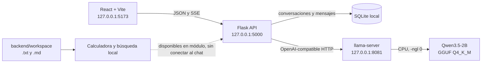

# Informe del proyecto Chat Qwen local en CPU

**Proyecto revisado:** `D:\Ai Projects\chat-onnx-local`  
**Fecha de revisión:** 2026-09-23  
**Alcance:** lectura de documentación, configuración y código fuente. No inicié la aplicación ni ejecuté sus pruebas o benchmarks.

## Resumen ejecutivo

`chat-onnx-local` es una aplicación de chat local con una interfaz React/Vite, una API Flask, persistencia SQLite y un servidor de inferencia `llama.cpp`. La configuración documentada usa **Qwen3.5-2B en GGUF Q4_K_M**, con **cero capas en GPU** y ejecución en CPU. Aunque el directorio y algunos antecedentes usan “onnx”, el código y la configuración examinados no usan ONNX Runtime: el artefacto activo es GGUF y el motor es `llama-server`.

La API conserva conversaciones y mensajes, arma el historial y lo envía al endpoint compatible con OpenAI de `llama.cpp`. La respuesta se puede solicitar de una vez o transmitir mediante SSE. Hay una pequeña implementación de calculadora y búsqueda de archivos locales, pero la ruta de chat no las registra con el modelo ni las ejecuta; la demostración de tool routing en los scripts es texto de prompt y no ejecución real de herramientas.

El repositorio contiene físicamente el GGUF de aproximadamente **1,27 GB**, binarios Windows de `llama.cpp` y una base SQLite local. Modelo, binarios, base, logs y estado de procesos están excluidos de Git según `.gitignore`.

## Arquitectura

### Componentes y responsabilidades

| Componente | Ubicación | Responsabilidad |
|---|---|---|
| Interfaz | `frontend/src/main.tsx`, `frontend/src/style.css` | Lista y selección de conversaciones, envío de mensajes, streaming, estado del modelo y controles de generación. |
| Servidor web de desarrollo | `frontend/vite.config.ts` | Sirve React en el puerto 5173. El navegador consulta Flask directamente; no se configura proxy de Vite. |
| API y orquestación | `backend/app/api/routes.py` | CRUD de conversaciones, historial, llamadas síncronas y streaming a `llama-server`, estado/modelo y conteo de tokens. |
| Aplicación Flask | `backend/app/__init__.py`, `backend/run.py` | Configura SQLite, CORS, rutas, host y puerto. Por defecto escucha en `127.0.0.1:5000`. |
| Persistencia | `backend/app/database.py` | Crea y accede directamente a tablas SQLite para conversaciones y mensajes. |
| Motor local | `llm/bin/llama-server.exe` y DLLs | Expone health, modelos y chat completions compatibles con OpenAI. |
| Configuración de LLM | `llm/src/config.mjs` | Resuelve modelo, host, puerto, contexto, threads y capas GPU; incluye prueba unitaria. El arranque PowerShell duplica estos valores y no importa este módulo. |
| Herramientas | `backend/app/tools/` | Registro pequeño de herramientas, calculadora AST y búsqueda textual bajo `backend/workspace`. No están conectadas al flujo de chat. |
| Inicio y parada | `run.ps1`, `stop.ps1` | Inicia llama-server, Flask y Vite en ese orden, espera readiness y guarda PID; parada con `taskkill /T`. |

Los tres servicios usan por defecto loopback. Flask permite CORS desde `127.0.0.1:5173` y `localhost:5173`, ajustable con `CORS_ORIGIN`.

## Modelo e inferencia

- **Modelo configurado:** Qwen3.5-2B, formato GGUF, cuantización Q4_K_M.
- **Ruta configurada:** `llm/models/Qwen3.5-2B-Q4_K_M.gguf`.
- **Archivo encontrado en disco:** 1.270.808.032 bytes (aprox. 1,27 GB decimal).
- **Motor:** llama.cpp; se encontraron `llama-server.exe`, `llama-cli.exe`, `llama-bench.exe` y las bibliotecas necesarias en `llm/bin/`.
- **Parámetros documentados por defecto:** CPU (`LLM_GPU_LAYERS=0`), contexto 4096, 4 threads, batch y ubatch 512, una secuencia/slot (`-np 1`), sin prompt cache, reasoning deshabilitado y métricas activadas.
- **Endpoint utilizado por Flask:** `POST /v1/chat/completions`; el backend manda `model`, `messages`, `temperature`, `top_p`, `max_tokens`, `stream` y `chat_template_kwargs.enable_thinking=false`.

El script de inicio toma el contexto, threads, GPU layers, batch y ubatch de variables de entorno y los pasa como flags al servidor. El servidor se inicia desde `llm/bin`, por eso el modelo se referencia allí como `..\models\...`.

## Interfaz y comportamiento del chat

La aplicación React es una SPA compacta implementada en un solo `main.tsx`:

- Barra lateral con conversaciones existentes y botón para crear un chat nuevo.
- Selección de una conversación y carga de mensajes guardados.
- Área de mensajes de usuario/asistente y renderizado Markdown con GitHub Flavored Markdown.
- Compositor de mensajes: Enter envía y Shift+Enter agrega una línea.
- Envío bloqueado mientras se genera; texto del usuario y una respuesta vacía se agregan de forma optimista.
- Lectura de SSE para mostrar deltas de texto; al terminar recarga los mensajes persistidos.
- Estado del modelo consultado cada cinco segundos (`Ready`, `Offline`, `Generating`, `Error`, entre otros).
- Panel de opciones para contexto, máximo de respuesta, temperatura, `top_p` y prompt de sistema.
- Tema oscuro adaptable a ventanas estrechas.

El título se cambia automáticamente desde el primer mensaje (máximo 60 caracteres) mientras conserva el título inicial `New chat`. La API permite cambiar o eliminar conversaciones, pero la interfaz actual no expone controles de renombrado o borrado.

La interfaz tiene valores iniciales adicionales (`top_k`, `repetition_penalty`, `enable_thinking`), pero el backend no reenvía `top_k` ni `repetition_penalty`. También guarda una opción `context_window` de 2048/4096, pero `llama_payload()` no la envía; el contexto efectivo queda fijado al iniciar llama-server. El prompt de sistema y los valores de temperatura, `top_p` y tokens sí se envían.

## API y flujo de datos

La API se publica bajo `/api`:

| Método y ruta | Función |
|---|---|
| `GET /api/health` | Devuelve estado del backend, SQLite y consulta `/health` al motor LLM. |
| `GET /api/conversations` | Lista conversaciones por `updated_at` descendente. |
| `POST /api/conversations` | Crea una conversación UUID con título y ajustes normalizados. |
| `GET /api/conversations/<id>` | Obtiene una conversación y parsea sus ajustes JSON. |
| `PATCH /api/conversations/<id>` | Cambia título y/o ajustes. |
| `DELETE /api/conversations/<id>` | Elimina la conversación; mensajes relacionados tienen borrado en cascada. |
| `GET /api/conversations/<id>/messages` | Obtiene los mensajes ordenados cronológicamente. |
| `POST /api/chat` | Guarda el prompt, envía todo el historial a llama-server y devuelve la respuesta completa. |
| `POST /api/chat/stream` | Igual que el anterior, pero convierte deltas del servidor en eventos SSE `delta` y `done`. |
| `GET /api/model/status` | Proxy al health del motor; devuelve 503 si no está disponible. |
| `GET /api/model/info` | Proxy a `/v1/models`. |
| `POST /api/model/token-count` | Proxy a `/tokenize` para contar tokens. |

En cada turno, Flask valida que existan `conversation_id` y contenido, carga la conversación y todos sus mensajes, normaliza ajustes, persiste primero el nuevo mensaje de usuario, actualiza título/fecha y luego llama al motor. El modo no streaming persiste también tokens y timings recibidos. En streaming concatena los deltas y persiste la respuesta final; la UI vuelve a consultar la conversación al terminar.

### Datos locales

SQLite contiene dos tablas:

- `conversations`: UUID, título, fechas de creación/actualización y `settings_json`.
- `messages`: UUID, conversación asociada, rol restringido a `system`, `user`, `assistant` o `tool`, contenido, fecha, tokens opcionales y `metadata_json`.

La conexión activa `PRAGMA foreign_keys=ON`. Las tablas se inicializan con `CREATE TABLE IF NOT EXISTS` al crear la app; no hay Alembic ni migraciones versionadas. La ruta por defecto es `backend/data/chat.db`, y el archivo está ignorado por Git. No inspeccioné el contenido de la base local.

No hay autenticación, cuentas, aislamiento entre usuarios, límites de historial ni paginación. Es un prototipo para uso local de una persona, no una API multiusuario.

## Herramientas locales

`backend/app/tools/` define una interfaz `Tool` y un registro con:

1. **`calculator`**: interpreta expresiones usando un AST permitido para constantes numéricas, operaciones aritméticas y signos unarios; no ejecuta `eval`. Incluye límites simples sobre operandos.
2. **`search_text`**: busca palabras en archivos `.txt` y `.md` bajo `backend/workspace`, cuenta coincidencias literales sin distinguir mayúsculas, devuelve fragmentos de hasta 2000 caracteres y limita `top_k` a 1–10.

`get_tools()` está desactivado por defecto; `execute()` puede invocar el registro desde Python. Ninguna ruta API llama a `get_tools()` ni a `execute()`, y el payload de chat no declara herramientas para llama.cpp. No existe `get_document` en el registro. Los prompts de los scripts que piden JSON de selección de herramientas prueban la capacidad verbal del modelo, no el despacho ni ejecución de esas herramientas.

## Configuración y arranque

`.env.example` documenta hosts y puertos, modelo, contexto, threads, batch/ubatch, capas GPU, temperatura, `top_p`, URL interna de llama-server, ruta SQLite y orígenes CORS. El `.env` real no estaba presente en la raíz al inspeccionar; no leí secretos.

`run.ps1`:

1. Lee `.env` si existe; usa valores por defecto en caso contrario.
2. Verifica que haya Node, npm, Python, el GGUF y binarios llama.cpp.
3. Crea un virtualenv si falta e instala Flask si no encuentra el directorio del paquete.
4. Instala dependencias frontend con `npm install` cuando no existe `frontend/node_modules`.
5. Inicia llama-server y espera `/health`; inicia Flask y espera `/api/health`; por último inicia Vite y abre la URL local.
6. Escribe PIDs bajo `.runtime/` y redirige salida a `logs/`.

`stop.ps1` ejecuta `taskkill.exe /T /F` para los PID guardados de frontend, backend y llama-server, y elimina esos archivos PID. El README documenta Windows, Node/npm, Python 3.11+ y PowerShell; no encontré scripts de inicio Linux/macOS.

### Observaciones operativas

- El script comprueba la presencia de Node/Python, pero no valida sus versiones concretas.
- Aunque existe `frontend/package-lock.json`, el primer setup llama `npm install`, no `npm ci`.
- Si falta `.env`, el arranque usa defaults; no copia automáticamente `.env.example`.
- Los límites de puerto no se comprueban antes de `Start-Process`; el error aparecerá durante el readiness si un puerto está ocupado.
- `LLM_MODEL` se usa para verificar una ruta, pero el argumento de `llama-server` está escrito como `..\models\Qwen3.5-2B-Q4_K_M.gguf`; cambiar solo esa variable no cambia el modelo cargado.
- `stop.ps1` confía en que un PID guardado aún pertenezca al proceso de Jobkler y no contrasta ruta o línea de comandos antes de terminar el árbol. Si el PID quedara obsoleto y el sistema lo reutilizara, convendría añadir una comprobación de identidad.
- La limpieza de fallo de `run.ps1` detiene PID individuales; `stop.ps1` es el que intenta bajar los árboles de procesos.
- El `.env.example` incluye `LLM_TEMPERATURE` y `LLM_TOP_P`, pero el backend usa ajustes de cada conversación y no lee esas dos variables.
- `llm/scripts/benchmark-threads.ps1` detiene procesos por nombre (`llama-server`) antes de cada corrida, sin comprobar si pertenecen a este proyecto; no es tan acotado como el `stop.ps1` principal.

## Pruebas y benchmarks documentados

### Pruebas automatizadas que se ven en el repositorio

- **Backend:** 8 pruebas pytest para health con LLM offline, CRUD de conversación, límites de settings, calculadora, contrato de chat síncrono, streaming, UTF-8 y respuesta de error si llama-server está caído. Usan una base temporal y mock del motor para el contrato de chat.
- **Configuración LLM:** una prueba verifica nombre/ruta del GGUF, contexto 4096 y capas GPU 0.
- **Contrato HTTP LLM:** la prueba consulta `/health` solo cuando `RUN_LLM_TESTS=1`; de otro modo termina sin hacer una solicitud.
- **Frontend:** se declara Vitest y un comando `test`, pero no encontré archivos de pruebas frontend en el inventario examinado.
- **Batería general:** `scripts/test-all.ps1` invoca las tres suites, build y lint. Su opción `-RealModel` intenta `npm run smoke` en el paquete `llm`, pero `llm/package.json` no declara un script `smoke`. El texto además menciona Playwright, que no aparece como dependencia ni configuración visible.

No ejecuté estas pruebas; la lista describe el código de pruebas y scripts.

### Mediciones registradas en documentación

Los informes anotan mediciones reales previas, fechadas **2026-09-20**, en AMD Ryzen 5 5500, 12 procesadores lógicos y 16 GB RAM, llama.cpp b11052, contexto 4096 y CPU-only. Según esos documentos:

| Métrica | Qwen3.5-0.8B Q4_K_M | Qwen3.5-2B Q4_K_M |
|---|---:|---:|
| Mejor threads de generación | 6 | 4 |
| Generación `tg128` | 56,65 tok/s | 26,82 tok/s |
| Procesamiento prompt `pp512` (mejor) | 370,32 tok/s | 171,04 tok/s |
| TTFT E2E Flask promedio | 226,0 ms | 523,4 ms |
| Tiempo total E2E promedio | 2.807,1 ms | 6.353,4 ms |
| RSS después de prompts | 0,94–0,98 GB | 1,95–2,03 GB |
| RAM estable en 10 generaciones | 1.147,6 MB | 2.494,6 MB |

La comparación indica que el 2B retuvo 47,34% de la velocidad de generación del 0.8B y fue aproximadamente 2,1× más lento en TTFT, 2,3× en tiempo total y usó alrededor de 2,2× la RAM estable. Los documentos reportan memoria conversacional, JSON y streaming como satisfactorios; la clasificación exacta `tributos` falló en ambos modelos. Estos números se transcriben de los informes; no los reproduje durante esta revisión.

El benchmark histórico del 0.8B se preserva en `docs/benchmark-qwen35-08b-final.md`; la comparación completa está en `docs/benchmark-qwen35-08b-vs-2b.md`. En `llm/models/` solo encontré físicamente el GGUF de 2B. `TEST_REPORT.md` conserva una nota de transición que dice que la eliminación física del 0.8B se haría después de completar pruebas, por lo que ese texto parece no haberse actualizado tras la transición.

## Límites y puntos a tener presentes

1. **No es ONNX:** GGUF y llama.cpp son la ruta de inferencia actual.
2. **Herramientas sin integración:** calculadora y búsqueda local existen como módulos Python, pero el chat no las llama; `get_document` no está implementada.
3. **Ajustes parcialmente efectivos:** `context_window`, `top_k` y `repetition_penalty` se muestran o guardan, pero no forman parte del payload efectivo de llama.cpp.
4. **Historial sin recorte:** cada petición incluye toda la conversación, aunque el servidor se configura con contexto 4096; los chats largos pueden exceder el contexto disponible.
5. **Persistencia antes de inferencia:** si el motor está caído, el mensaje del usuario ya quedó guardado; un reintento puede añadir otro turno con el mismo texto.
6. **Streaming:** la ruta parsea deltas y guarda el resultado acumulado; no hay evento SSE explícito para errores upstream ocurridos después de abrir la respuesta.
7. **Solo Windows documentado:** el launcher y el stopper son PowerShell; no encontré equivalente Linux/macOS.
8. **Dependencias frontend poco fijadas:** `frontend/package.json` declara varias dependencias como `latest`; hay lockfile, pero el launcher usa `npm install`.
9. **Privacidad y exposición:** los servicios por defecto se limitan a loopback, pero la API no tiene autenticación ni separación de conversaciones.

## Archivos principales consultados

- `README.md`, `TEST_REPORT.md`
- `docs/benchmark-qwen35-08b-final.md`, `docs/benchmark-qwen35-08b-vs-2b.md`
- `run.ps1`, `stop.ps1`, `.env.example`, `.gitignore`
- `backend/app/__init__.py`, `backend/app/api/routes.py`, `backend/app/database.py`
- `backend/app/tools/base.py`, `backend/app/tools/registry.py`, `backend/app/tools/calculator.py`, `backend/app/tools/search_text.py`
- `backend/tests/test_app.py`, `backend/tests/conftest.py`
- `llm/src/config.mjs`, `llm/package.json`, `llm/test/`
- `frontend/src/main.tsx`, `frontend/src/style.css`, `frontend/package.json`, `frontend/vite.config.ts`
- `scripts/acceptance.ps1`, `scripts/quality-battery.ps1`, `scripts/test-all.ps1`, `scripts/benchmark-e2e.mjs`
