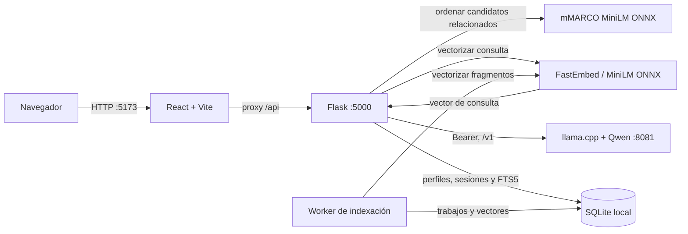
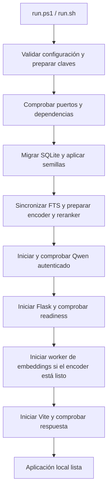
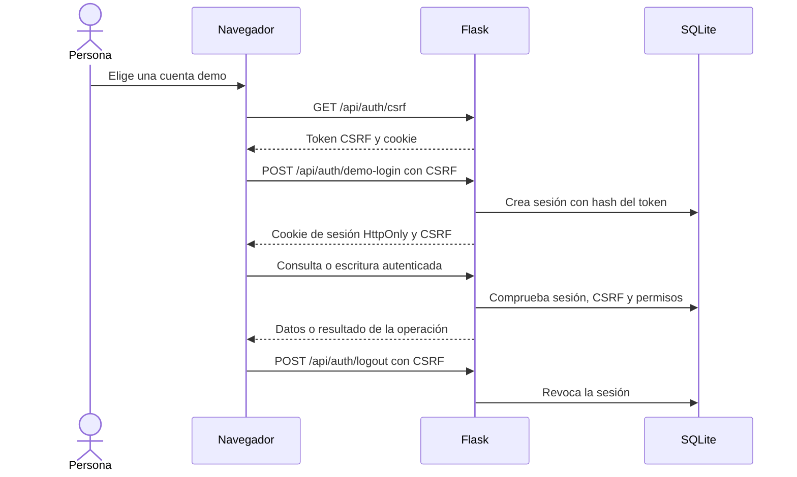
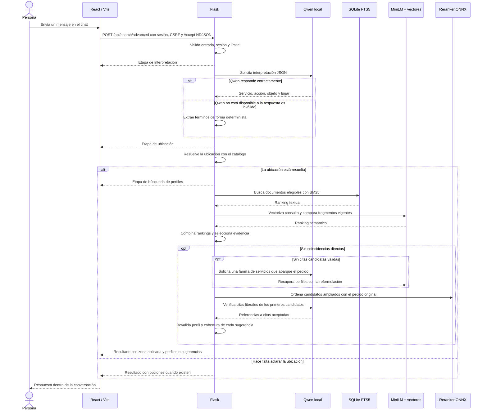
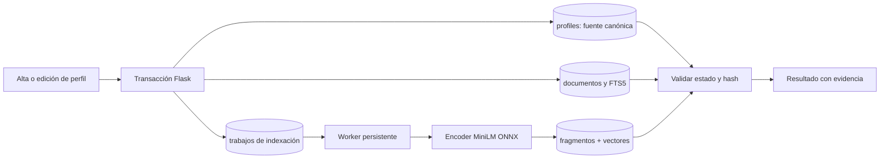

# Arquitectura actual de Quien.uy local

Esta guía describe la demo local actual. El informe [Arquitectura.md](../Arquitectura.md) describe una etapa anterior y se conserva como antecedente.

## Componentes y límites

- Vite sirve la interfaz y redirige `/api` a Flask con el mismo origen del navegador. El navegador no llama a Qwen ni recibe su clave.
- Flask administra perfiles, reseñas, catálogos, sesiones y búsqueda. La fuente canónica es SQLite en `backend/instance/`; los contactos no se incluyen en los documentos de búsqueda.
- El catálogo resuelve pedidos simples de un oficio conocido. Qwen interpreta los demás mediante un objeto JSON validado. El encoder MiniLM calcula vectores para recuperar perfiles relacionados.
- El worker actualiza los fragmentos vectorizados fuera de la transacción que guarda el perfil. Los documentos FTS se sincronizan al escribir y se vuelven a comprobar por hash antes de mostrar resultados. FastEmbed es una biblioteca cargada por los procesos que la usan, no un servidor independiente.
- Los procesos se ejecutan en loopback. El modelo GGUF, el ejecutable de llama.cpp, el caché ONNX, los secretos, logs y la base no se versionan en Git.

## Arranque local

Si el encoder no se prepara, el arranque continúa con recuperación semántica reducida. Con el motor administrado habilitado, un conflicto de puerto o la falta del modelo detienen el inicio con un diagnóstico. `stop.ps1` o `stop.sh` detienen los procesos registrados por Jobkler tras comprobar su identidad.

## Sesión y operaciones sobre perfiles

La consulta pública de perfiles devuelve los publicados. Una cuenta autenticada puede crear hasta un perfil, y solo su propietaria puede editarlo, desactivarlo o borrarlo. Al guardar un perfil se actualiza el índice textual y se encola la indexación semántica. Las reseñas requieren sesión, CSRF y validaciones de autoría; la cuenta moderadora puede ocultarlas o publicarlas.

| Ruta | Uso principal |
| --- | --- |
| `GET /api/catalog` | Categorías, departamentos y localidades. |
| `GET /api/profiles` y `GET /api/profiles/{id-o-slug}` | Búsqueda y consulta pública de perfiles. |
| `POST /api/profiles`, `PATCH /api/profiles/{id}`, `DELETE /api/profiles/{id}` | Crear o administrar el perfil propio. |
| `POST /api/profiles/{id}/status` | Activar o desactivar el perfil propio. |
| `GET /api/reviews`, `POST /api/reviews` | Consultar o publicar reseñas. |
| `GET /api/auth/csrf`, `POST /api/auth/demo-login`, `POST /api/auth/logout` | Obtener CSRF, iniciar y cerrar sesión demo. |
| `POST /api/search/advanced` | Búsqueda avanzada autenticada. |
| `GET /api/health/ready` | Comprobar Flask y esquema SQLite; no certifica Qwen. |

## Búsqueda avanzada

Qwen tiene un único turno de inferencia. Una consulta adicional espera hasta 10 segundos por defecto; si no consigue turno, recibe una respuesta recuperable. Los límites y el comportamiento detallado están en [Busqueda-Avanzada.md](Busqueda-Avanzada.md).

## Datos e indexación

La semilla inicial crea 42 perfiles demo, nueve fixtures de búsqueda, 300 perfiles ampliados y 43 perfiles con tareas detalladas. En una base nueva hay 394 registros, de los cuales 388 comienzan activos. Los datos son ficticios y las semillas de población se aplican una vez.

## Ubicación del código

| Responsabilidad | Ubicación |
| --- | --- |
| Rutas y formularios | `src/router/`, `src/pages/AdvancedSearchPage.tsx` |
| Cliente HTTP y sesión | `src/api/client.ts`, `src/lib/auth.tsx` |
| API y políticas de sesión | `backend/app/api/`, `backend/app/services/sessions.py` |
| Contrato e interpretación Qwen | `backend/app/search/contracts.py`, `backend/app/search/llm.py` |
| Ranking, filtros y evidencia | `backend/app/search/engine.py`, `backend/app/search/catalog.py` |
| Índice y embeddings | `backend/app/search/documents.py`, `indexer.py`, `encoder.py`, `model_manifest.py` |
| Datos sintéticos | `backend/app/seed_data.py`, `backend/app/search/fixtures.py`, `expanded_fixtures.py` |
| Motor y procesos | `ai-engine/engine.py`, `run.ps1`, `run.sh`, `stop.ps1`, `stop.sh` |

## Autenticación y modos

La demo usa cuentas ficticias y sesiones de backend con cookie HttpOnly; las escrituras y la búsqueda avanzada requieren CSRF. FusionAuth es una configuración separada y no está validada aquí con credenciales reales. La búsqueda avanzada de esta entrega está restringida a la demo local autenticada; no se presenta como despliegue productivo.
